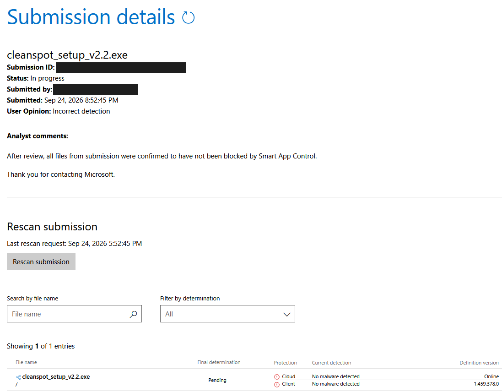

  

&nbsp;

  

<b>SYS_LOG: Microsoft Security Response</b>

 

> After review, one or more files from submission were confirmed to be
> incorrectly blocked by Smart App Control. This has now been remediated,
> and the file(s) will no longer be blocked.

*Note: CleanSpot is not code-signed yet, so Windows SmartScreen may still warn on first launch — click **More info** → **Run anyway**.*

 

CleanSpot is free and always will be. If it optimized your rig, support the dev:  

 

<table>
  <tr>
    <td width="50%"></td>
    <td width="50%"></td>
  </tr>
  <tr>
    <td width="50%"></td>
    <td width="50%"></td>
  </tr>
  <tr>
    <td width="50%"></td>
    <td width="50%"></td>
  </tr>
</table>

 

Most cleaners just delete temp files and call it a day. CleanSpot goes further — it **shows you what's actually eating your disk**, **repairs a broken Windows install**, and **removes programs down to the last registry key**. One app, seven tabs, no subscriptions, no bloat.

Built for gamers and power users, in **Arabic and English** — and sharp on any screen, from 100% to 150%+ scaling.

 

Text version

 

| MODULE | FUNCTIONALITY |
|---|---|
| **System Cleaning** | Reclaim space across 20+ targets — Windows Temp, browser and shader caches, crash dumps, and more. Scan first, clean only what you pick. |
| **Disk Analyzer** | A treemap of every folder, a duplicate finder verified with full SHA-256, big-file lists, and one-click cleanup suggestions. System files are never listed for deletion. |
| **Startup Manager** | Everything that launches with Windows — Run keys, Startup folders and hidden Task Scheduler entries. Switch any of it off, and back on, anytime. |
| **Deep Uninstaller** | Removes programs completely — files, AppData, shortcuts, services, scheduled tasks and registry keys. Waits for Steam & Epic to finish. |
| **System Repair** | Run SFC and DISM with real progress and real results, plus component-store cleanup to reclaim space from old updates. |
| **Network Repair** | Quick fix (flush DNS, renew IP) or a full network reset when the internet misbehaves — with a restart prompt when it's needed. |
| **PC Specs** | Every component at a glance — copy any value with one click, export a full report, or **restart straight into your BIOS**. |
| **Hardware Monitor** | Live CPU, GPU, RAM and disk usage with clock speeds, NVIDIA GPU temperature, and a temperature alert in the tray where the board supports it. |
| **Modern Interface** | Crisp at any Windows scaling, Windows icons throughout, and 8 accent colours with dark / light themes — all remembered between sessions. |
| **Localization** | Full right-to-left Arabic, switchable anytime with one click. |

 

1. Download **`CleanSpot_Setup_v2.4.exe`** from the [Releases page](../../releases/latest).
2. Run the installer and follow the steps.
3. Launch CleanSpot from the desktop shortcut or the Start Menu.

> [!NOTE]
> **SYS_UPDATE:** Already installed? The new version installs over the old one — your settings are kept.

> [!WARNING]
> **SECURITY_OVERRIDE:** CleanSpot isn't code-signed yet, so Windows may show a SmartScreen warning. Click **More info → Run anyway** — this is expected for new, unsigned apps.

`REQUIREMENTS` Windows 10 (1809) or later, 64-bit · Administrator rights.

 

1. Launch CleanSpot — it will request administrator access.
2. Review the cleaning targets; common-safe ones are enabled by default.
3. Click **SCAN ONLY** to preview, or **TURBO CLEAN** to clean now.
4. Explore the **Startup**, **Disk Analyzer**, **Uninstaller** and **Repair** tabs.

 

- **Open source** — the released build can be reproduced from this code.
- Every clean, uninstall and delete is written to a **daily log** (`%LOCALAPPDATA%\CleanSpot\logs`).
- A **system restore point** can be created before uninstalling programs.
- Disk Analyzer deletes go to the **Recycle Bin**, not permanent deletion.
- **System files are protected** — pagefile, hibernation file, Windows and program folders never appear in the Big Files list.
- **Destructive buttons are always red**, whatever theme you pick, so risky actions are easy to spot.
- No kernel driver, no background service, no hardware-monitoring library.

 

Found a bug or have an idea? Feedback is always welcome. If you'd like to support development, the PayPal button is at the top — thank you.

&nbsp;

 

